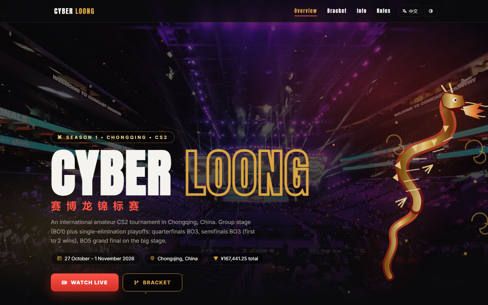

# Cyber Loong Championship 🐉 — сайт CS2-турнира + админка

> Esports tournament website with a live bracket, streams and an admin panel. Express API, works as a static site too. EN / 中文.

**▶ Демо: https://quorvox.github.io/cyber-loong/** (сайт в демо-режиме, без API и админки)



Лендинг любительского CS2-турнира в Чунцине: команды, групповой этап, плей-офф сетка, трансляции (свой плеер / YouTube / Twitch), отели и правила. Всё содержимое правится из админки без кода.

## Фишки

- **Работает и без сервера**: в `index.html` вшиты демо-данные, так что сайт можно залить на любой статический хостинг. Если рядом есть API, данные подтянутся живые (в подвале горит статус)
- **Сетка плей-офф** со слотами (`A1`, `Winner QF1` …), которые сами заменяются командами, когда те известны
- **Два языка**: английский и китайский, переключатель в шапке
- **Админка**: команды (лого, состав, страна, W/L), матчи (стадия, BO, счёт, статус, стрим), настройки турнира, трансляции
- Тёмная/светлая тема, адаптив под телефон

## Безопасность админки

- пароль хранится как bcrypt-хеш, наружу не отдаётся
- первый пароль ставится **только с localhost** или через `ADMIN_PASSWORD` в `.env`, иначе на хостинге админом стал бы первый зашедший
- токены живут 12 часов, есть logout
- антибрут: 5 неверных паролей → бан IP на 15 минут
- на публичный хост уходит только `public/`, админка живёт отдельно

## Стек

Node.js, Express, bcryptjs, ванильный JS, JSON-файл как БД.

```
public/index.html   — весь сайт (одна страница)
admin-panel/        — админка (отдельный хост)
server.js           — API
database.example.json — демо-данные, при первом старте копируются в database.json
```

## Запуск

```bash
npm install
npm start
# сайт:    http://localhost:4000
# админка: http://localhost:4000/manage/admin.html
```

## Фото

Wikimedia Commons, свободные лицензии (CC BY / CC BY-SA), авторы подписаны на сайте: IEM Katowice 2018 (Portal PcModpl), ESL Gamescom 2019 (dronepicr), Taipei Game Show 2019 (Solomon203), Chongqing Yuzhong (Jonipoon).

Турнир, команды и спонсоры выдуманные, это демо-проект.

---
Сделано [Quorvox_team](https://github.com/Quorvox)
